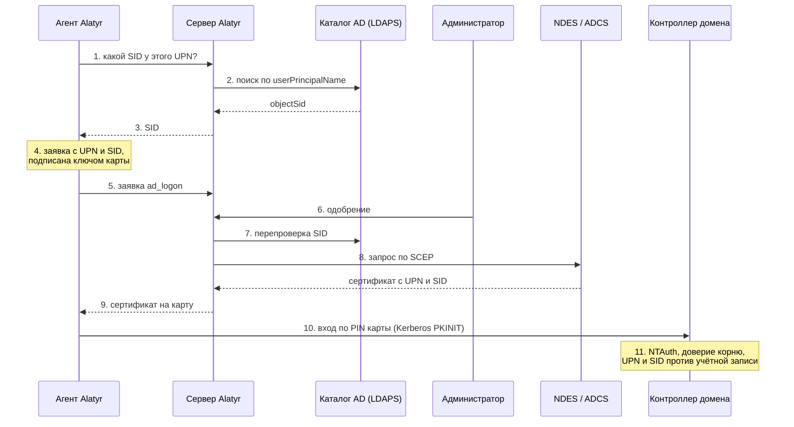

# Откуда берутся UPN и SID

Сертификат для входа в домен удостоверяет человека двумя значениями: **UPN**
(`userPrincipalName`, имя вида `ivanov@corp.example`) и **SID** (`objectSid`,
неизменяемый идентификатор учётной записи). Контроллер домена сверяет с
учётной записью оба. Здесь — откуда Alatyr берёт каждое из них, кому при этом
доверяет и что для этого настроить.

## Принцип

Агент на устройстве знает, **кто** входит, — UPN сотрудника. SID он не
утверждает: за ним сервер Alatyr сам обращается к вашему каталогу Active
Directory по UPN и возвращает агенту ответ каталога. Агент кладёт UPN и SID в
заявку, подписанную ключом карты; при одобрении сервер ещё раз сверяет SID с
каталогом, а ваш УЦ (ADCS через NDES) выпускает сертификат. При входе
контроллер домена находит по сертификату учётную запись и проверяет, что SID в
сертификате — её SID: это и есть строгое сопоставление сертификата с учётной
записью (KB5014754).

Доверие распределено так:

| Сторона | Что знает | Чему доверяет |
|---|---|---|
| Агент | UPN сотрудника | ответу сервера о SID |
| Сервер Alatyr | ничего своего — спрашивает каталог | только каталогу; заявлению устройства о SID — нет |
| Каталог AD | UPN и SID каждой учётной записи | — это источник истины |
| Контроллер домена | учётные записи и NTAuth | сертификату вашего УЦ, если UPN и SID в нём совпали с учётной записью |

## Как идёт выдача



1. Агент выбирает UPN сотрудника (порядок источников — ниже) и спрашивает у
   сервера, какой SID ему соответствует.
2. Сервер подключается к каталогу учётной записью только для чтения и ищет
   пользователя с этим `userPrincipalName`.
3. Найдена ровно одна учётная запись — сервер возвращает её `objectSid`.
4. Агент собирает заявку: UPN в альтернативном имени, SID там же, в форме,
   которую Microsoft определила для KB5014754. Заявку подписывает ключ карты,
   который устройство не покидает.
5. Заявка `ad_logon` уходит на сервер.
6. Администратор одобряет её. Автоматического одобрения у этой цели нет.
7. Перед выдачей сервер ещё раз спрашивает каталог и сверяет SID заявки с
   ответом. Расхождение — отказ.
8. Сервер передаёт заявку вашему УЦ через NDES (SCEP); шаблон берёт имя из
   заявки, поэтому UPN и SID переходят в сертификат как есть.
9. Агент кладёт сертификат на карту.
10. Сотрудник входит в Windows или в сеанс RDP по PIN карты.
11. Контроллер домена проверяет цепочку и NTAuth, находит учётную запись по
    UPN и сверяет SID. Alatyr в этом шаге не участвует.

## Откуда UPN

Агент берёт первый непустой источник из списка:

1. **Переопределение оператора** — UPN, заданный на устройстве командой
   `alatyr-agent ad-logon-upn`. Он стоит первым, потому что оператор знает
   каталог, а агент нет.
2. **Корпоративная личность сотрудника**, под которой агент выпускает и
   остальные пользовательские цели: почта, заданная при установке агента
   (`ALATYR_CORP_EMAIL`), а если она не задана — `<логин>@<корпоративный
   домен>` (`ALATYR_CORP_DOMAIN`). На Mac, привязанном к каталогу, домен к
   короткому имени может достроить сама привязка.

Нет ни одного источника — заявка не подаётся, и агент пишет об этом в журнал.
Выдумывать UPN агент не станет: УЦ подпишет любое имя, а откажет уже
контроллер домена — в момент входа.

**UPN обязан совпасть с `userPrincipalName` учётной записи в AD.** Почтовый
суффикс и суффикс UPN у организаций часто разные: почта
`ivanov@mail.corp.example`, UPN `ivanov@corp.example`. Тогда каталог по почте
человека не найдёт, и сертификат выпишется без SID. Задайте UPN явно — на
устройстве сотрудника, от его имени:

```
alatyr-agent ad-logon-upn ivanov@corp.example   # задать
alatyr-agent ad-logon-upn                       # показать, что задано
alatyr-agent ad-logon-upn --clear               # вернуться к корпоративной почте
```

Новый UPN действует со следующей заявки; уже выданный сертификат не меняется —
выпустите его заново (`alatyr-agent reissue ad_logon`).

Какой бы источник ни дал UPN, решение принимает человек: администратор видит
UPN в заявке и одобряет именно его, а сервер сверяет имя в заявке с
одобренной личностью ещё раз непосредственно перед выдачей.

## Откуда SID

SID знает только каталог, и спрашивает его только сервер Alatyr.

**Что именно спрашивается.** Поиск идёт в поддереве `ALATYR_DIRECTORY_BASE_DN`
по фильтру «пользователь с этим `userPrincipalName`», читается единственный
атрибут — `objectSid`. Ответ принимается, только если запись ровно одна: две
записи с одинаковым UPN — противоречие в каталоге, и сервер отказывает, а не
выбирает наугад. UPN перед подстановкой в фильтр экранируется.

**Учётная запись привязки — только для чтения.** Ей нужно найти пользователя по
`userPrincipalName` и прочитать его `objectSid`; в каталог сервер не пишет
никогда. Если у вас есть клиенты вне домена, той же учётной записи нужно ещё
право читать раздел конфигурации леса — оттуда сервер берёт списки отзыва для
таких машин ([«Вход по RDP»](rdp.md#клиент-вне-домена-списки-отзыва-контроллера)).
У обычной доменной учётной записи оба права есть по умолчанию. Привилегированные
группы ей не нужны: работать лучше она в них не станет, а компрометация
сервера станет компрометацией домена.

**Соединение.** Для каждого запроса открывается новое соединение и закрывается
после ответа. Рекомендуемый адрес — `ldaps://<контроллер домена>:636`:
сертификат контроллера проверяется по доверенным корням системы образа
сервера, а пароль привязки идёт внутри TLS. Корня внутреннего ЦС среди них нет
— его добавляют файлом корней ([как](walkthrough.md#71-доверие-к-вашему-цс-сеть-ndes-и-имена-домена)). С адресом `ldap://` пароль привязки
уходит по сети открыто. Отключать проверку сертификата
(`ALATYR_DIRECTORY_INSECURE_SKIP_VERIFY=true`) допустимо только на
испытательной установке с самоподписанным сертификатом контроллера.

**Таймаут.** Подключение и поиск вместе ограничены
`ALATYR_DIRECTORY_TIMEOUT_SECONDS` (по умолчанию 5 секунд): неотвечающий
контроллер не подвешивает выдачу.

**Кто и про кого может спросить.** Устройство предъявляет свой
регистрационный токен и может спросить про SID не любого человека, а только:

- про того, для кого на этом устройстве уже есть одобренный сертификат (обычно
  это `user_mtls` того же сотрудника);
- про того, кого администратор назвал для этого устройства в **выписанном
  задании**;
- про любого другого — в пределах суточной квоты: не больше
  `ALATYR_DIRECTORY_SID_DAILY_LIMIT` различных личностей в сутки на устройство
  (по умолчанию 3; `0` запрещает такие вопросы вовсе). Считаются личности, а не
  запросы: повторный вопрос про уже учтённого человека квоту не тратит.

Отказ на все прочие случаи один и тот же и выдаётся до обращения к каталогу —
по ответу нельзя отличить «квота исчерпана» от «такой учётной записи нет».
Иначе обладатель токена одного устройства получил бы справочник по всему
каталогу. Частота самих запросов к серверу ограничена так же, как у остальных
запросов регистрации.

**Перепроверка при одобрении.** SID в заявку кладёт устройство, поэтому сервер
не полагается на то, что оно донесло ответ без изменений: при одобрении он
снова спрашивает каталог.

| Результат перепроверки | Что происходит |
|---|---|
| SID совпал | выдача продолжается |
| SID не совпал | одобрение отклоняется: сертификат пустил бы в систему не того |
| заявка несёт SID, а учётной записи с таким UPN в каталоге нет | одобрение отклоняется |
| в заявке нет SID | выдача продолжается, в журнале сервера — предупреждение, что вход в домен по такому сертификату не заработает |
| каталог не ответил | выдача продолжается, в журнале сервера — ошибка «SID не перепроверен» |

Недоступный контроллер домена не останавливает выдачу всему парку — но и не
проходит молча.

### Куда SID попадает в сертификате

Агент кладёт SID в альтернативное имя заявки в виде
`tag:microsoft.com,2022-09-14:sid:<SID>` — так Microsoft предписывает
передавать SID для строгого сопоставления (KB5014754), когда шаблон берёт имя
из заявки. Дату в этой строке менять не нужно: это часть идентификатора, а не
срок.

Контроллер домена в режиме строгого сопоставления принимает вход по
сертификату, только если сертификат надёжно привязан к учётной записи. SID и
есть эта привязка. Сертификат без SID при этом выпускается без ошибок, несёт
нужные назначения и годится для mTLS, — а отказ увидит сотрудник на экране
входа.

## Почему SID не берётся из Windows на клиенте

Сервер не принимает SID на слово от клиента: сертификат с этим SID открывает
вход в систему от имени человека, и правильность такого значения не должна
зависеть от устройства. Поэтому единственный источник SID — каталог, а сервер
перепроверяет его при одобрении.

Есть и практическая причина. Заявку подписывает ключ карты, поэтому SID должен
оказаться в заявке до подписи — дописать его на сервере нельзя. Взять его на
самом устройстве агенту негде:

- на Windows заявку собирает часть агента, работающая от имени сотрудника, без
  системных привилегий — системный токен сеанса ей недоступен, и это сделано
  намеренно;
- у локальной учётной записи на Windows вне домена SID машинный, домену он
  неизвестен;
- на macOS и Linux доменного SID у пользователя нет вовсе.

Поэтому порядок одинаков для всех платформ: агент спрашивает сервер, сервер
спрашивает каталог.

## Настройка

Подключение к каталогу задаётся переменными окружения сервера:

| Переменная | Обязательна | Что это |
|---|---|---|
| `ALATYR_DIRECTORY_URL` | да | адрес контроллера домена, `ldaps://dc.corp.example:636` |
| `ALATYR_DIRECTORY_BIND_DN` | да | DN учётной записи только для чтения |
| `ALATYR_DIRECTORY_BIND_PASSWORD` | да | её пароль; лучше передавать файлом (`ALATYR_DIRECTORY_BIND_PASSWORD_FILE`) |
| `ALATYR_DIRECTORY_BASE_DN` | да | поддерево поиска с компонентами `DC=`, например `DC=corp,DC=example` |
| `ALATYR_DIRECTORY_INSECURE_SKIP_VERIFY` | нет, `false` | не проверять сертификат контроллера — только для испытаний |
| `ALATYR_DIRECTORY_SID_DAILY_LIMIT` | нет, `3` | сколько новых личностей устройство может разрешить в SID за сутки |
| `ALATYR_DIRECTORY_TIMEOUT_SECONDS` | нет, `5` | потолок на подключение и поиск |

Подробные описания — в [«Конфигурации»](../configuration.md#каталог-ldapad-sid-для-входа-в-домен-по-карте).

В составе Docker Compose впишите строки в `.env` (образцы с пояснениями есть в
`.env.example`; в наборе развёртывания — раздел «Каталог Active Directory»).
В Kubernetes те же переменные передаются через `server.extraEnv` чарта.

```
ALATYR_DIRECTORY_URL=ldaps://dc.corp.example:636
ALATYR_DIRECTORY_BIND_DN=CN=alatyr-ldap,CN=Users,DC=corp,DC=example
ALATYR_DIRECTORY_BIND_PASSWORD=<пароль>
ALATYR_DIRECTORY_BASE_DN=DC=corp,DC=example
```

и перезапустите сервер:

```bash
docker compose up -d
docker compose logs | grep -i каталог
```

**Результат.** В журнале сервера строка `каталог настроен` с адресом и
поддеревом поиска. Строка `каталог не настроен (ALATYR_DIRECTORY_URL пуст)`
означает, что переменные до сервера не дошли.

Заданный адрес без DN привязки, пароля или поддерева — не «выключенный
каталог», а **отказ запуска** сервера со строкой `настройки каталога неполны` и
названной причиной: неполная настройка обнаруживается при старте, а не в
момент, когда сертификата ждёт сотрудник.

### Как проверить, что SID попал в сертификат

После выдачи на машине сотрудника:

```powershell
certutil -scinfo -silent                     # карта и её сертификат
certutil -dump <файл-сертификата.cer> | findstr /C:"Principal Name" /C:"sid:"
```

**Результат.** В `Principal Name` — UPN сотрудника, и рядом строка вида
`URL=tag:microsoft.com,2022-09-14:sid:S-1-5-21-…`. SID в ней должен совпадать с
каталогом:

```powershell
Get-ADUser -Filter "UserPrincipalName -eq 'ivanov@corp.example'" | Select-Object SID
```

Затем вход по карте: на контроллере домена событие **4768** с `Result Code 0x0`
и вашим УЦ в издателях — вход прошёл при строгом сопоставлении.

В журнале агента успешный путь виден строкой `ad_logon: SID получен из
каталога`.

## Если каталог не настроен или недоступен

Во всех случаях ниже сертификат **выпускается без SID**: он годится для mTLS,
карта видна, плитка входа появляется — но контроллер домена в режиме строгого
сопоставления вход отвергает. В журнале агента об этом строка `ad_logon:
каталог не сообщил SID — сертификат выпишется, но входа в домен по нему не
будет`.

| Что случилось | Что видно в журнале сервера | Что делать |
|---|---|---|
| каталог не настроен | при запуске `каталог не настроен (ALATYR_DIRECTORY_URL пуст)`; при одобрении `каталог не настроен, SID из заявки НЕ перепроверяется` | задать переменные `ALATYR_DIRECTORY_*` ([«Настройка»](#настройка)) |
| настройка неполна | сервер не запускается: `настройки каталога неполны` | дописать недостающее — причина названа в той же строке |
| контроллер недоступен, таймаут, TLS, неверный пароль | `directory sid: lookup failed` с причиной | проверить адрес, порт, доверие к сертификату контроллера и учётную запись привязки |
| учётной записи с таким UPN нет | — (у агента: `no account with this upn`) | задать верный UPN командой `alatyr-agent ad-logon-upn` или поправить `userPrincipalName` в AD |
| две учётные записи с одним UPN | `more than one account has this upn` | устранить дубль в каталоге |
| учётной записи привязки не дают прочитать `objectSid` | `has no objectSid attribute (is the bind account allowed to read it?)` | выдать ей право чтения |
| человек не связан с устройством, квота исчерпана | `отказано — личность не одобрена человеком, и суточная квота на новые личности исчерпана` | выписать задание на этого человека и эту машину или дождаться следующих суток |
| SID в заявке не совпал с каталогом | `ad_logon отклонён: SID в заявке не совпал с каталогом` | одобрение отклонено намеренно: выяснить, почему устройство прислало чужой SID, либо не сменилась ли учётная запись |

После исправления **выпустите сертификат заново**: заявка `ad_logon` сама не
подаётся повторно. От имени сотрудника на его машине:

```
alatyr-agent reissue ad_logon
```

Новая заявка снова придёт на одобрение.

## Что дальше

- [Настройка](setup.md) — пошаговый порядок: домен, ADCS, каталог, админка,
  устройство.
- [От Windows Server до входа по RDP](walkthrough.md) — весь путь с нуля, с
  командами и проверкой каждого шага.
- [Вход по RDP](rdp.md) — тот же сертификат при входе на удалённый рабочий стол.
- [Пределы и нюансы](caveats.md) — чего механизм не обещает.
