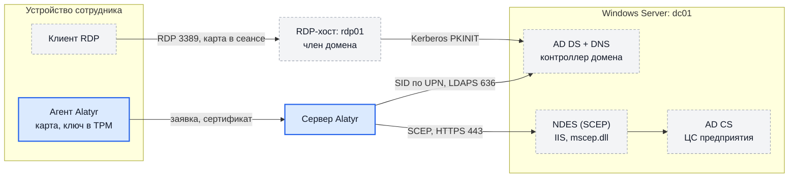

# От Windows Server до входа по RDP: руководство целиком

Это руководство проводит через весь путь на пустом месте: от свежей установки
Windows Server до того, как сотрудник со своего устройства входит на удалённый
рабочий стол по карте Alatyr, не вводя пароль. Каждый шаг заканчивается
проверкой — переходите к следующему, только когда проверка прошла.

Если домен, УЦ и NDES у вас уже есть, начните с [шага 5](#шаг-5-строгое-сопоставление-ntauth-и-доверие-к-уц);
короткий порядок для готовой инфраструктуры — в [«Настройке»](setup.md). Как
сертификат получает UPN и SID сотрудника — в [«Откуда берутся UPN и
SID»](identity.md).

!!! note "Имена в примерах"
    Домен — `corp.example` (NetBIOS `CORP`), контроллер домена и УЦ —
    `dc01.corp.example`, сервер Alatyr — `alatyr.corp.example`, машина, на
    которую входят по RDP, — `rdp01.corp.example`, сотрудник —
    `ivanov@corp.example`. Подставьте свои.

## Шаг 1. Требования и схема



| Компонент | Что нужно | Комментарий |
|---|---|---|
| Контроллер домена | Windows Server 2022 с актуальными накопительными обновлениями | обновления нужны для строгого сопоставления сертификатов (KB5014754) |
| ЦС предприятия (AD CS) | Enterprise Root CA или подчинённый ЦС предприятия | в руководстве — на том же сервере, что и контроллер |
| NDES | роль службы регистрации сетевых устройств, IIS с HTTPS | на том же сервере, что и ЦС, либо на отдельном члене домена |
| Сервер Alatyr | установлен по [«Установке»](../installation.md#сервер) | должен достигать `dc01` по 443 (NDES) и 636 (LDAPS) |
| RDP-хост | Windows, член домена, с полным доменным именем в DNS | вход по карте возможен только по имени, не по IP-адресу |
| Устройство сотрудника | Windows 10/11 с TPM 2.0 и агентом Alatyr | в домене или вне его; с Linux — см. [«Вход по RDP → С Linux»](rdp.md#с-linux) |

Сетевые доступы: агент → сервер Alatyr (API); сервер Alatyr → `dc01:636`
(LDAPS) и NDES по HTTPS; клиент → RDP-хост по 3389; RDP-хост → контроллер
домена (Kerberos). Клиенту вне домена доступ к контроллеру не обязателен.

**Как убедиться.** Схема нарисована для вашей сети: известны имена всех узлов,
открыты перечисленные порты.

## Шаг 2. Windows Server: AD DS, контроллер домена, DNS

На чистом Windows Server, от имени локального администратора:

```powershell
Install-WindowsFeature AD-Domain-Services -IncludeManagementTools

Install-ADDSForest -DomainName 'corp.example' -DomainNetbiosName 'CORP' `
    -SafeModeAdministratorPassword (Read-Host -AsSecureString 'Пароль DSRM') `
    -InstallDns -NoRebootOnCompletion -Force
Restart-Computer
```

После перезагрузки войдите доменным администратором. Готовность определяйте
по ответу каталога, а не по тому, что машина загрузилась:

```powershell
Get-ADDomain | Select-Object DNSRoot, NetBIOSName, DomainMode
Resolve-DnsName dc01.corp.example
```

У сотрудников, которые будут входить по карте, заполните атрибуты:

- `userPrincipalName` — **обязательно**, по нему сервер Alatyr найдёт SID;
- `displayName` — желательно: это имя в плитке входа, без него там дважды
  стоит UPN.

Клиентам и RDP-хосту укажите DNS-сервером контроллер домена; RDP-хост введите
в домен (`Add-Computer -DomainName corp.example -Restart`).

**Как убедиться.** `Get-ADDomain` отвечает, `Resolve-DnsName` находит
контроллер, `Get-ADUser ivanov -Properties displayName` показывает UPN и имя.

## Шаг 3. AD CS: ЦС предприятия и шаблон для входа по карте

### 3.1. Установите ЦС предприятия

Учётной записи, которая ставит ЦС предприятия, нужно членство в **Enterprise
Admins**; после добавления в группу выйдите из системы и войдите снова. Без
этого установка падает с `0x80072082`, и в тексте ошибки нет ни слова о
правах.

```powershell
Install-WindowsFeature ADCS-Cert-Authority -IncludeManagementTools

Install-AdcsCertificationAuthority -CAType EnterpriseRootCA `
    -CACommonName 'Corp Issuing CA' `
    -KeyLength 2048 -HashAlgorithmName SHA256 `
    -ValidityPeriod Years -ValidityPeriodUnits 10 -Force
```

**Как убедиться.** `certutil -ping` отвечает, а
`Get-ItemProperty 'HKLM:\SYSTEM\CurrentControlSet\Services\CertSvc\Configuration'`
показывает имя ЦС в значении `Active`.

### 3.2. Создайте шаблон сертификата

В консоли шаблонов (`certtmpl.msc`) сделайте копию шаблона **Smartcard Logon**
(«Вход со смарт-картой») и назовите её, например, `CorpSmartcardLogon`. В
копии:

| Вкладка | Значение | Почему |
|---|---|---|
| **Subject Name** | **Supply in the request**; флажок «User principal name» в альтернативном имени снят | при SCEP заявителем выступает служебная запись NDES: имя из каталога было бы её именем, а не сотрудника |
| **Extensions → Application Policies** | **Smart Card Logon** и **Client Authentication** | без назначений в политике приложений шаблон второй версии выпускает сертификат без EKU вовсе |
| **Extensions → Key Usage** | только цифровая подпись | с шифрованием ключа карта отвергает сертификат как несовпадающий с ключом |
| **Request Handling** | назначение — подпись; **экспорт закрытого ключа не разрешать** | с флагом экспорта выдача на карту падает с `0x80090009` ещё до обращения к ЦС |
| **Cryptography** | RSA, минимальная длина ключа **2048**; провайдер смарт-карты | ключ карты Alatyr — RSA-2048; ключ короче или другого типа ЦС отвергает |
| **Security** | право **Enroll** — только служебной записи NDES (шаг 4) | «имя из заявки» позволяет заявителю попросить любой UPN, поэтому заявителей должно быть ровно один |

Проверьте получившийся шаблон значениями, а не галочками на экране:

```powershell
$root = (Get-ADRootDSE).configurationNamingContext
$dn = "CN=CorpSmartcardLogon,CN=Certificate Templates,CN=Public Key Services,CN=Services,$root"
$t = Get-ADObject $dn -Properties 'msPKI-Certificate-Name-Flag','msPKI-Private-Key-Flag',
     'msPKI-Certificate-Application-Policy','msPKI-Minimal-Key-Size'
$n = [int64]$t.'msPKI-Certificate-Name-Flag'
"ENROLLEE_SUPPLIES_SUBJECT: {0}" -f (($n -band 0x00000001) -ne 0)            # True
"SUBJECT_ALT_REQUIRE_UPN:   {0}" -f (($n -band 0x02000000) -ne 0)            # False
"EXPORTABLE_KEY:            {0}" -f (([int]$t.'msPKI-Private-Key-Flag' -band 0x10) -ne 0)  # False
$t.'msPKI-Certificate-Application-Policy'   # 1.3.6.1.4.1.311.20.2.2 и 1.3.6.1.5.5.7.3.2
$t.'msPKI-Minimal-Key-Size'                 # 2048
```

### 3.3. Опубликуйте шаблон на ЦС

```powershell
Restart-Service CertSvc -Force
certutil -SetCATemplates "+CorpSmartcardLogon"
certutil -CATemplates
```

Форма с `+` добавляет шаблон к списку, а не заменяет список. Если только что
созданный шаблон командлет `Add-CATemplate` называет несуществующим —
перезапустите службу ЦС и опубликуйте через `certutil`, как выше.

**Как убедиться.** `certutil -CATemplates` перечисляет `CorpSmartcardLogon`, а
проверка флагов дала значения из комментариев.

## Шаг 4. NDES: адрес SCEP для сервера Alatyr

NDES принимает заявку по протоколу SCEP и передаёт её ЦС от имени своей
служебной учётной записи. Сервер Alatyr ходит именно сюда.

### 4.1. Служебная учётная запись

Заведите доменного пользователя, например `CORP\svc-ndes`, и дайте ему:

- право **Enroll** на шаблон `CorpSmartcardLogon` (шаг 3.2) — и никому больше;
- право **Enroll** на шаблоны `CEPEncryption` и `EnrollmentAgentOffline` и
  опубликуйте оба на ЦС (`certutil -SetCATemplates "+CEPEncryption"`,
  `certutil -SetCATemplates "+EnrollmentAgentOffline"`): по ним NDES при
  установке получает свои сертификаты регистрирующего агента. По умолчанию
  они не опубликованы, и установка падает на этом запросе.

Установку NDES и правку прав на шаблоны выполняйте доменным администратором.

### 4.2. Установите роль

Установите роль **Network Device Enrollment Service** (Server Manager или
`Install-AdcsNetworkDeviceEnrollmentService`) со служебной учётной записью из
4.1 — по [документации
Microsoft](https://learn.microsoft.com/windows-server/identity/ad-cs/network-device-enrollment-service-overview).
Две особенности:

- если NDES ставится на тот же сервер, что и ЦС, **не указывайте** параметр
  `-CAConfig` — с ним установка отказывает с `0x8007139f`;
- в разделе реестра `HKLM\SOFTWARE\Microsoft\Cryptography\MSCEP` укажите
  ваш шаблон в значениях `SignatureTemplate`, `EncryptionTemplate` и
  `GeneralPurposeTemplate` (подробно — в той же документации Microsoft) и
  перезапустите IIS: `iisreset`.

### 4.3. Пароль заявки (challenge) выключите

Сервер Alatyr **не передаёт** NDES пароль заявки: по SCEP пароль кладётся
внутрь самой заявки, а заявку подписывает ключ карты на устройстве сотрудника,
и дописать в неё что-либо на сервере нельзя. Поэтому проверку пароля на NDES
выключите:

```powershell
Set-ItemProperty 'HKLM:\SOFTWARE\Microsoft\Cryptography\MSCEP\EnforcePassword' `
    -Name EnforcePassword -Value 0 -Type DWord
iisreset /restart
```

Значение должно лежать **в подразделе** `EnforcePassword`, а не в самом
`MSCEP`. Страница `mscep_admin` при этом не нужна, а поле **«SCEP challenge»** в
админке Alatyr оставьте пустым.

!!! danger "NDES без пароля должен быть доступен только серверу Alatyr"
    Шаблон берёт имя из заявки, и пароль не проверяется: любой, кто дотянется
    до `mscep.dll`, сможет попросить сертификат входа на любой UPN. Закройте
    доступ к NDES сетевыми правилами так, чтобы до него доходил только сервер
    Alatyr. Граница доверия при этом — сервер Alatyr: он сверяет имя заявки с
    утверждённой человеком личностью, а заявку «Вход в AD» одобряет только
    человек.

### 4.4. HTTPS и адрес

Админка Alatyr принимает адрес SCEP **только по `https`**. Привяжите к сайту
IIS на сервере NDES сертификат с полным доменным именем этого сервера,
выданный вашим ЦС. Адрес для Alatyr:

```
https://dc01.corp.example/certsrv/mscep/mscep.dll
```

### 4.5. Отпечаток ЦС

Alatyr сверяет ЦС, которому передаёт заявку, по отпечатку **SHA-256
сертификата ЦС**. NDES в ответ на `GetCACert` отдаёт несколько сертификатов —
два своих (регистрирующего агента) и сертификат ЦС; нужен именно сертификат
ЦС. Пин на сертификат агента тоже сработает, но выдача остановится в день его
перевыпуска.

Не берите поле «Thumbprint» из оснастки: оно показывает SHA-1. На сервере ЦС:

```powershell
certutil -ca.cert C:\Windows\Temp\ca.cer
certutil -hashfile C:\Windows\Temp\ca.cer SHA256
```

Или с любой машины, у которой есть `openssl`:

```bash
curl -s "https://dc01.corp.example/certsrv/mscep/mscep.dll/pkiclient.exe?operation=GetCACert" -o ca.p7b
openssl pkcs7 -inform DER -in ca.p7b -print_certs \
  | openssl x509 -noout -subject -fingerprint -sha256
```

(`openssl x509` печатает первый сертификат из списка; найдите среди
напечатанных `-print_certs` тот, у которого subject — ваш ЦС.)

**Как убедиться.** Запрос возможностей отвечает списком, в котором есть
`POSTPKIOperation` и `SHA-256`:

```bash
curl -s "https://dc01.corp.example/certsrv/mscep/mscep.dll/pkiclient.exe?operation=GetCACaps"
```

Отпечаток SHA-256 сертификата ЦС записан — он понадобится в шаге 7.

## Шаг 5. Строгое сопоставление, NTAuth и доверие к УЦ

**Строгое сопоставление (KB5014754).** Контроллер домена с актуальными
обновлениями принимает вход по сертификату, только если сертификат надёжно
привязан к учётной записи. Alatyr обеспечивает такую привязку SID сотрудника в
сертификате: агент кладёт его в альтернативное имя заявки в виде
`tag:microsoft.com,2022-09-14:sid:<SID>`, и шаблон с «именем из заявки»
переносит его в сертификат. Ослаблять режим сопоставления на контроллерах для
этого **не нужно** — достаточно актуальных обновлений и каталога для SID из
шага 6. Режимы и сроки — в [KB5014754](https://support.microsoft.com/help/5014754).

**NTAuth.** Контроллер домена доверяет выпуск сертификатов для входа только
тем ЦС, что опубликованы в хранилище NTAuth. ЦС вне NTAuth выпустит
безупречный сертификат, который Windows всё равно отвергнет на экране входа.
От имени администратора домена:

```powershell
& certutil.exe "-ca.cert" C:\Windows\Temp\ca.cer
& certutil.exe -dspublish -f C:\Windows\Temp\ca.cer NTAuthCA
& certutil.exe -dspublish -f C:\Windows\Temp\ca.cer RootCA    # у ЦС предприятия корень обычно уже опубликован
& certutil.exe -pulse
```

В PowerShell аргумент `-ca.cert` берите в кавычки: без них команда молча
ничего не делает. Если контроллеров несколько — `repadmin /syncall /d /e /P`.

На клиентах и RDP-хосте перед первой пробой:

```
gpupdate /force
certutil -pulse
```

**Как убедиться.** Объект `CN=NTAuthCertificates,CN=Public Key
Services,CN=Services,CN=Configuration,DC=corp,DC=example` содержит ваш ЦС
(`certutil -viewstore -enterprise NTAuth` показывает его в окне), а
`certutil -verifystore -enterprise Root` на клиенте находит корень.

## Шаг 6. Каталог для SID

SID сотрудника сервер Alatyr берёт у контроллера домена по UPN — учётной
записью только для чтения, по LDAPS. Без этого шага сертификат выпишется без
SID и вход по нему контроллер отвергнет. Принцип, права и поведение при
сбоях — [«Откуда берутся UPN и SID»](identity.md).

### 6.1. Учётная запись только для чтения

Обычный доменный пользователь без дополнительных прав: читать `objectSid` и
раздел конфигурации леса может любая доменная учётная запись. Заводите в три
действия — если пароль задать прямо в `New-ADUser` и он не пройдёт политику
паролей, объект всё равно создастся, но отключённым и без пароля:

```powershell
New-ADUser -Name 'svc-alatyr-ldap' -SamAccountName 'svc-alatyr-ldap' `
    -UserPrincipalName 'svc-alatyr-ldap@corp.example' `
    -Path 'CN=Users,DC=corp,DC=example' -Enabled $false
Set-ADAccountPassword -Identity 'svc-alatyr-ldap' -Reset
Enable-ADAccount -Identity 'svc-alatyr-ldap'
Set-ADUser 'svc-alatyr-ldap' -PasswordNeverExpires $true
```

В привилегированные группы её не добавляйте.

### 6.2. LDAPS

Контроллер домена в лесу с ЦС предприятия обычно сам получает сертификат и
начинает слушать порт 636. Проверьте с машины сервера Alatyr:

```bash
openssl s_client -connect dc01.corp.example:636 -servername dc01.corp.example </dev/null \
  | openssl x509 -noout -subject -issuer
```

Издателем должен быть ваш ЦС. Сервер Alatyr проверяет сертификат
контроллера — и сертификат NDES из шага 4 — по доверенным корням своей
системы, а корня вашего ЦС там нет. Как его добавить — в шаге 7.1.

### 6.3. Переменные сервера

В `.env` сервера Alatyr:

```
ALATYR_DIRECTORY_URL=ldaps://dc01.corp.example:636
ALATYR_DIRECTORY_BIND_DN=CN=svc-alatyr-ldap,CN=Users,DC=corp,DC=example
ALATYR_DIRECTORY_BIND_PASSWORD=<пароль>
ALATYR_DIRECTORY_BASE_DN=DC=corp,DC=example
```

`ALATYR_DIRECTORY_BASE_DN` обязан содержать компоненты `DC=`. Прочие параметры
(таймаут, суточная квота) — в [«Конфигурации»](../configuration.md#каталог-ldapad-sid-для-входа-в-домен-по-карте).

**Как убедиться** — после перезапуска сервера в шаге 7.1: в журнале строка
`каталог настроен`.

## Шаг 7. Сервер Alatyr: доверие, издатель, политика

### 7.1. Доверие к вашему ЦС, сеть NDES и имена домена

Всё задаётся в `.env` набора развёртывания и одним файлом — правка
`docker-compose.yml` и отдельный override не нужны.

**Корень вашего ЦС в доверии** — для LDAPS к контроллеру и HTTPS к NDES.
Выгрузите сертификат ЦС (шаг 4.5 уже положил его в `C:\Windows\Temp\ca.cer`),
переведите в PEM и положите в каталог `trust` рядом с `docker-compose.yml`:

```bash
openssl x509 -inform der -in ca.cer -out trust/corp-root.pem
chmod 644 trust/corp-root.pem
```

Сервер доверяет этому корню **вдобавок** к системным. Если между корнем и
сертификатами контроллера есть промежуточные ЦС — положите их в тот же файл
подряд.

**Разрешение ходить в частную сеть NDES.** Издатель SCEP по умолчанию не
ходит на частные адреса (защита от подделки запросов на стороне сервера), а
NDES в локальной сети всегда на таком адресе. Укажите адрес NDES как можно
уже — с маской `/32`.

В `.env` — вместе с переменными каталога из шага 6.3:

```
ALATYR_EXTRA_CA_FILE=/etc/alatyr/trust/corp-root.pem
ALATYR_SCEP_INTERNAL_CIDRS=192.0.2.10/32
```

Путь в `ALATYR_EXTRA_CA_FILE` — внутри контейнера: каталог `trust` набора
виден серверу как `/etc/alatyr/trust`. Ключ `ALATYR_SCEP_ENC_KEY`, которым
шифруются настройки издателя SCEP, набор заводит сам при первом запуске;
не меняйте его — иначе сохранённые настройки издателя перестанут
расшифровываться.

**Имена домена разрешаются на машине сервера.** Сервер ходит к контроллеру
и NDES по полному доменному имени — по нему же выписаны их сертификаты.
Проверьте с машины сервера и из контейнера:

```bash
getent hosts dc01.corp.example
docker compose exec server nslookup dc01.corp.example
```

!!! warning "Домен в зоне `.local` на Debian и Ubuntu"
    `systemd-resolved` по умолчанию отправляет имена `*.local` только в
    mDNS, и `getent` отвечает «не найдено», хотя DNS-сервер сети имя знает.
    Контейнеры при этом получают `SERVFAIL`. Укажите зону явно:

    ```bash
    sudo mkdir -p /etc/systemd/resolved.conf.d
    printf '[Resolve]\nDNS=<DNS-сервер, знающий зону>\nDomains=~corp.local\n' \
      | sudo tee /etc/systemd/resolved.conf.d/corp-local.conf
    sudo systemctl restart systemd-resolved
    ```

Затем перезапустите сервер:

```bash
docker compose up -d
docker compose logs server | grep -E 'каталог|корни TLS'
```

**Как убедиться.** В журнале строки `дополнительные корни TLS добавлены к
системным` и `каталог настроен` — а не `каталог не настроен` и не
`настройки каталога неполны`.

### 7.2. Издатель для цели «Вход в AD»

**Настройки → Удостоверяющие центры** → строка **«Вход в AD»** →
**«Изменить»**:

| Поле | Значение |
|---|---|
| Бэкенд | `SCEP` — другого у этой цели не бывает |
| SCEP URL | `https://dc01.corp.example/certsrv/mscep/mscep.dll` |
| Отпечаток CA (SHA-256) | отпечаток из шага 4.5; двоеточия, пробелы и регистр не важны |
| SCEP challenge | **пусто** (шаг 4.3) |
| Защита ключа | **«PIN самой карты»** |
| Включён | да |

**«PIN самой карты»** — единственная ступень, при которой карта работает в
сеансе RDP: ключ подписывает по PIN, который человек вводит в окне Windows.
Ступень применяется только к новому ключу устройства, поэтому выберите её
**до** первой выдачи.

Нажмите **«Проверить соединение»**: она проходит имя, TLS, получение
сертификата ЦС и сверку отпечатка.

### 7.3. Политика выдачи

**Настройки → Политика выдачи** → в колонке **«Выдаём»** включите **«Вход в
AD (смарт-карта)»**. На свежей установке включён только Wi-Fi.

**Как убедиться.** У строки «Вход в AD» в «Удостоверяющих центрах» статус
**«Настроен»**, проверка соединения успешна, а в «Политике выдачи» в колонке
**«Готовность»** — «Готов — политика разрешает, ЦА настроен».

## Шаг 8. RDP-хост

Машина, на которую входят: член домена `corp.example`, с полным доменным
именем в DNS. От имени её администратора:

```powershell
# приём подключений и NLA
Set-ItemProperty 'HKLM:\System\CurrentControlSet\Control\Terminal Server' fDenyTSConnections 0
Set-ItemProperty 'HKLM:\System\CurrentControlSet\Control\Terminal Server\WinStations\RDP-Tcp' UserAuthentication 1
New-NetFirewallRule -DisplayName 'RDP' -Direction Inbound -Protocol TCP -LocalPort 3389 -Action Allow
Add-LocalGroupMember 'Remote Desktop Users' 'CORP\Domain Users'
```

Зарегистрируйте на цели минидрайвер карты — командой агента Alatyr из того же
выпуска; считыватель на цели не нужен, только регистрация:

```
alatyr-agent install-reader --minidriver-only
```

Без минидрайвера Windows не знает проброшенную карту и показывает на экране
входа «Connect a smart card» при полностью исправной остальной цепочке.

Рекомендуется не оставлять отключённые сеансы жить
(`MaxDisconnectionTime`, `fResetBroken` — групповая политика *Remote Desktop
Session Host → Session Time Limits*). Remote Credential Guard не обязателен;
если вы им пользуетесь — [«Вход по RDP», шаг 1](rdp.md#шаг-1-подготовьте-машину-цель).

**Как убедиться.** `Test-NetConnection rdp01.corp.example -Port 3389` с клиента
проходит, а на цели

```powershell
(Get-ItemProperty 'HKLM:\System\CurrentControlSet\Control\Terminal Server\WinStations\RDP-Tcp').UserAuthentication
```

показывает `1`.

## Шаг 9. Устройство сотрудника

### 9.1. Установите агента

На Windows-устройстве сотрудника, от имени администратора, — пакет из выпуска
([«Установка → Windows»](../installation.md#windows), там же доверие к
издателю пакета):

```powershell
msiexec /i alatyr-agent-<версия>-x64.msi /qn `
    ALATYR_SERVER=https://alatyr.corp.example `
    ALATYR_CORP_DOMAIN=corp.example
```

UPN сотрудника агент по умолчанию собирает как `<логин>@<корпоративный
домен>` либо берёт почту (`ALATYR_CORP_EMAIL`). Он обязан совпасть с
`userPrincipalName` в AD; если нет — задайте его от имени сотрудника:
`alatyr-agent ad-logon-upn ivanov@corp.example` ([«Откуда
UPN»](identity.md#откуда-upn)).

### 9.2. Назначьте цель и одобрите заявку

1. В админке: **Устройства** → строка машины → **«Разрешённые назначения
   сертификатов»** → отметьте `ad_logon` и сохраните. Или сотрудник просит цель
   сам, а вы разрешаете её в **«Запросах назначений»**.
2. Дальше агент всё делает сам: поднимает на устройстве смарт-карту
   (собственный считыватель, карта обслуживается штатным драйвером Windows),
   заводит в TPM ключ RSA-2048, узнаёт у сервера SID сотрудника, подаёт заявку
   с UPN и SID. Сотрудник при этом видит в окне Alatyr ход выдачи цели.
3. В **«Запросах»** появится заявка «Вход в AD» — одобрите её. Автоматического
   одобрения у этой цели нет; при одобрении сервер ещё раз сверяет SID с
   каталогом.

### 9.3. PIN карты

Сотрудник за своей машиной, один раз:

```powershell
'<PIN>' | & alatyr-agent.exe card-set-pin    # ключ создаётся ПОД этим PIN
'<PIN>' | & alatyr-agent.exe card-unlock     # предъявить PIN агенту
& alatyr-agent.exe card-prepare
```

То же — из окна Alatyr: раздел цели → **«Предъявить PIN карты»**. Попыток PIN
пять; на нуле ключ уничтожается. Подробности — [«Настройка», шаг
7](setup.md#шаг-7-заведите-pin-карты-на-устройстве).

**Как убедиться.**

```powershell
certutil -scinfo -silent
certutil -dump <файл-сертификата.cer> | findstr /C:"Principal Name" /C:"sid:"
```

`certutil -scinfo` показывает карту и сертификат; в сертификате `Principal
Name` — UPN сотрудника (не служебной записи NDES) и строка
`URL=tag:microsoft.com,2022-09-14:sid:S-1-5-21-…`. SID совпадает с
`Get-ADUser ivanov | Select SID`.

!!! note "Какие устройства могут входить"
    **Windows** — в домене и вне его. **Linux** — как клиент RDP, через
    `xfreerdp3` с поддержкой Kerberos ([«Вход по RDP → С Linux»](rdp.md#с-linux)).
    **macOS** — готового клиента RDP с входом по карте нет
    ([«Пределы и нюансы»](caveats.md#вход--только-в-windows)). Локальный вход
    по карте в саму машину не поддерживается намеренно — только удалённый
    рабочий стол.

## Шаг 10. Вход по RDP с картой

На устройстве сотрудника, от его имени:

1. Включите проброс карты в умолчаниях клиента RDP — один раз:

   ```
   alatyr-agent rdp --enable-redirect
   ```

2. Проверьте готовность — по полному доменному имени цели:

   ```
   alatyr-agent rdp --target rdp01.corp.example
   ```

   Ждите строки `готово: можно подключаться`. То же показывает окно Alatyr в
   разделе **«Подключение по RDP»**.
3. Подключитесь: `mstsc /v:rdp01.corp.example`. Не запускайте подключение из
   `.rdp`-файла — его диалог сбрасывает галочку проброса карты.
4. В окне учётных данных выберите плитку смарт-карты и введите **PIN карты**.
   Пароль нигде не вводится.

**Как убедиться.** Открылся рабочий стол `rdp01`. На контроллере домена в
журнале безопасности — событие **4768** (билет по сертификату, `Result Code
0x0`, издатель — ваш ЦС) и следом **4769**; на RDP-хосте — **4624** с типом
входа 10. Вход прошёл при строгом сопоставлении — значит, SID в сертификате
верный.

## Шаг 11. Если что-то не так

| Симптом | Причина | Что сделать |
|---|---|---|
| В журнале агента «каталог не сообщил SID», в сертификате нет строки `sid:` | каталог не настроен, недоступен или не нашёл UPN | [«Если каталог не настроен или недоступен»](identity.md#если-каталог-не-настроен-или-недоступен); после исправления `alatyr-agent reissue ad_logon` |
| Сервер не запускается: «настройки каталога неполны» | задан `ALATYR_DIRECTORY_URL` без DN, пароля или поддерева | дописать все четыре переменные (шаг 6.3) |
| В журнале сервера `x509: certificate signed by unknown authority` при обращении к каталогу или NDES | корень вашего ЦС не в доверии сервера | шаг 7.1: файл в `trust` и `ALATYR_EXTRA_CA_FILE` |
| Сервер не находит контроллер или NDES по имени (`no such host`), проверка издателя падает на имени | машина сервера не разрешает имена домена; для зоны `.local` — `systemd-resolved` | шаг 7.1, «Имена домена» |
| `LDAP Result Code 49` | неверный пароль учётной записи привязки | сверить `ALATYR_DIRECTORY_BIND_PASSWORD` с каталогом |
| Проверка издателя отвечает отказом из-за адреса (`blocked_target`) | NDES на частном адресе, не разрешённом серверу | `ALATYR_SCEP_INTERNAL_CIDRS` (шаг 7.1) |
| `CA fingerprint mismatch` | в админке отпечаток не того сертификата | взять SHA-256 сертификата ЦС (шаг 4.5) |
| Заявка в ошибке с `failInfo=badMessageCheck` | NDES требует пароль заявки | выключить `EnforcePassword` (шаг 4.3); журнал NDES — Application, источник `NetworkDeviceEnrollmentService` |
| Отказ из-за размера ключа (`0x80094811`) | шаблон требует ключ другого размера или типа | RSA, минимум 2048 (шаг 3.2) |
| В `Principal Name` служебная запись NDES; заявка в ошибке с двумя личностями | шаблон строит имя из каталога | «Supply in the request» (шаг 3.2), перевыпустить |
| В сертификате нет назначений (EKU) | пустая политика приложений у шаблона | добавить Smart Card Logon и Client Authentication (шаг 3.2) |
| `0x80090009` при выдаче на карту | в шаблоне разрешён экспорт закрытого ключа | снять флаг (шаг 3.2) |
| Вход отвергнут с ошибкой про сопоставление сертификата | ЦС не в NTAuth — самая частая причина; либо в сертификате нет SID | шаг 5; затем проверка SID (шаг 9.3) |
| Одобрение отклонено: «SID в заявке не совпал с каталогом» | устройство прислало не тот SID или учётная запись сменилась | разобраться до перевыпуска ([подробнее](identity.md#откуда-sid)) |
| «Connect a smart card» на удалённом экране | на цели нет минидрайвера; проброс не включён или сброшен диалогом `.rdp` | шаг 8 и шаг 10.1 |
| Подключение спрашивает пароль, карты нет | цель задана IP-адресом; либо сохранена учётная запись для этой цели | подключаться по полному доменному имени; `cmdkey /delete:TERMSRV/rdp01.corp.example` |
| «The revocation status of the domain controller certificate … could not be determined» | клиент вне домена не может достать списки отзыва | [«Клиент вне домена: списки отзыва»](rdp.md#клиент-вне-домена-списки-отзыва-контроллера) |
| «Key does not exist» | запись о карте указывает на прежний контейнер ключа | `alatyr-agent card-rebind` от имени сотрудника |
| «Provider could not perform the action since the context was acquired as silent» | переподключение к сеансу при выключенном NLA | включить NLA на цели (шаг 8) |

Больше разборов — [«Настройка → Если вход не проходит»](setup.md#если-вход-не-проходит)
и [«Вход по RDP → Если не получилось»](rdp.md#если-не-получилось).

## Что дальше

- [Откуда берутся UPN и SID](identity.md) — кто что знает и кому доверяет.
- [Пределы и нюансы](caveats.md) — отзыв, срок действия, продление и платформы.
- [Вход по RDP](rdp.md) — Remote Credential Guard, вход с Linux и клиенты вне
  домена.
