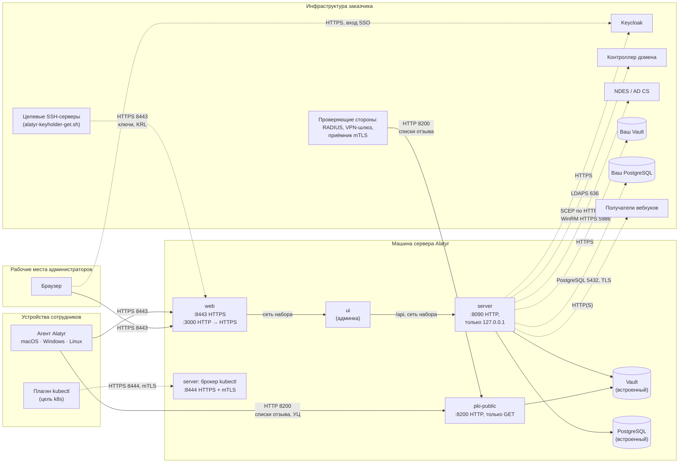
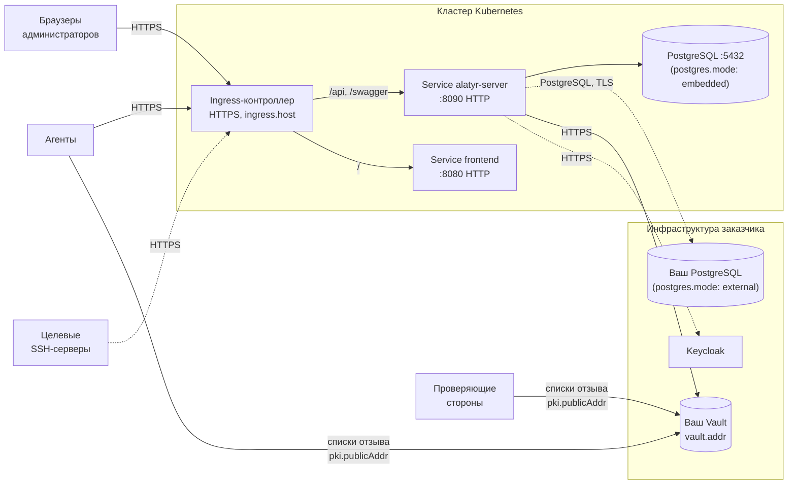

# Сеть и порты

Эта страница отвечает на вопросы сетевого администратора: какие порты
слушает сервер Alatyr, кто к ним подключается, куда сервер ходит сам и что
открыть на межсетевом экране между сегментами. Числа здесь — умолчания
набора развёртывания из выпуска (Docker Compose); каждое меняется
переменной в `.env`, она указана в таблице.

Три правила, из которых следует всё остальное:

- **Все соединения с устройствами начинает устройство.** Агент сам
  опрашивает сервер; сервер к устройствам не подключается никогда, и
  входящих портов на машинах сотрудников открывать не нужно.
- **Устройству нужны два адреса сервера:** `8443` — один https-вход для
  агентов и админки, и `8200` — списки отзыва и сертификаты УЦ. Третий,
  `8444`, — только если включена цель `k8s`.
- **К вашей инфраструктуре (Vault, PostgreSQL, Keycloak, контроллер домена,
  NDES) ходит только сервер Alatyr.** Агент и админка к ним не обращаются.

## Схема: набор развёртывания (Docker Compose)

Стрелка идёт **от того, кто открывает соединение**, к тому, кто его
принимает. Пунктир — необязательные связи: они появляются, только если
включена соответствующая возможность.



Встроенные Vault и PostgreSQL и ваши — взаимоисключающие варианты: в
установке работает либо одно, либо другое ([Своё или
внешнее](dependencies.md)). Порты самого Vault и PostgreSQL набора наружу
не публикуются: к ним обращается только сервер внутри сети набора.

## Почему агенты и админка ходят на один порт 8443

Порт `8443` — не «порт админки», к которому агенты подключаются заодно. Это
единственный https-вход набора: служба `web` принимает TLS-соединение и
передаёт запросы дальше по внутренней сети — страницы админки отдаёт `ui`,
а всё, что начинается с `/api`, уходит серверу. Агент, браузер и целевой
SSH-сервер приходят на один и тот же адрес и защищены одним сертификатом.

Порт `8090` — собственный порт сервера, **без TLS**. Поэтому набор
публикует его только на `127.0.0.1`: с самой машины им удобно проверять,
что сервер жив, а из сети на него не попасть. Так и задумано:

- агент с версии 1.6.1 не подключается по `http` к другой машине — только
  по `https`, с проверкой сервера по отпечатку корня;
- Keyholder отвечает целевым SSH-серверам только по TLS, а запрос по
  голому `http` снаружи получает `403 keyholder_requires_tls`;
- cookie входа в админку браузер сохраняет только на https-адресе.

Открывать `8090` в сеть (`ALATYR_API_BIND=0.0.0.0`) имеет смысл в одном
случае — перед ним стоит ваш обратный прокси на **другой** машине, который
сам терминирует TLS. Сервер тогда при старте пишет об этом предупреждение.
Временно этот же приём используют при обновлении агентов, настроенных на
`http://<сервер>:8090`, — порядок описан в [Быстром старте →
Обновление](quickstart.md).

Отдельный порт `8444` есть только у брокера `kubectl`, и причина в TLS:
брокер требует **клиентский сертификат** устройства, а на `8443` TLS
заканчивается на службе `web`, и сертификат сотрудника до сервера просто
не доходит. Поэтому у брокера свой слушатель с собственным TLS — подробнее
в [Доступ к Kubernetes → Настройка](k8s/setup.md).

## Порты на машине сервера Alatyr

Входящие подключения к серверу Alatyr.

| Порт | Протокол | Кто слушает | Кто подключается | Назначение | Обязателен | Как сменить |
|---|---|---|---|---|---|---|
| `8443` | TCP, HTTPS (TLS 1.2/1.3) | служба `web` | агенты, браузеры администраторов, целевые SSH-серверы | один https-вход: админка, API агентов, Keyholder (ключи и список отзыва SSH) | да | `ALATYR_HTTPS_PORT` |
| `3000` | TCP, HTTP | служба `web` | браузеры администраторов; ваш обратный прокси при `ALATYR_TLS=off` | перенаправление на `https://…:8443`; с самой машины (`localhost`) — админка без TLS. При `ALATYR_TLS=off` — вход для вашего прокси с TLS | нет; при `ALATYR_TLS=off` — да | `ALATYR_UI_PORT` |
| `8200` | TCP, HTTP, только `GET`/`HEAD` | служба `pki-public` | устройства сотрудников, проверяющие стороны (RADIUS, VPN-шлюз, приёмник mTLS), администраторы | списки отзыва (CRL) и сертификаты УЦ каждой цели. Остальные пути — `404`, остальные методы — `403`; сам Vault через этот порт недоступен | да, если сертификаты выпускает встроенный Vault | `ALATYR_PKI_PORT`; адрес, записанный в сертификаты, — `ALATYR_PKI_PUBLIC_ADDR` |
| `8090` | TCP, HTTP без TLS | служба `server` | только сама машина сервера (`127.0.0.1`) | прямой API сервера: проверка версии, диагностика | нет; в сеть не открывать | порт — `ALATYR_API_PORT`, адрес публикации — `ALATYR_API_BIND` |
| `8444` | TCP, HTTPS, mTLS | служба `server` (брокер `kubectl`) | плагин `kubectl` на устройстве сотрудника | выдача десятиминутных сертификатов для доступа к кластеру | только с целью `k8s` (накладка `docker-compose.k8s-broker.yml`) | `ALATYR_K8S_BROKER_PORT` и адрес `ALATYR_K8S_BROKER_URL` |
| `8445` | TCP, HTTPS | служба `keycloak-web` | браузеры администраторов | вход через встроенный Keycloak | только со встроенным Keycloak (накладка `docker-compose.keycloak-builtin.yml`, для ознакомления) | `ALATYR_KEYCLOAK_PORT` |

Порты `8443`, `3000`, `8090` и `8200` `./first-up.sh` проверяет до
подъёма: занятый другой программой порт — отказ с названием порта и
переменной. Порт `8444` он не проверяет.

!!! note "`ALATYR_TLS=off`: порт 8443 не обслуживается"
    В этом режиме служба `web` отдаёт всё по `http` на `ALATYR_UI_PORT`
    (`3000`), а TLS терминирует ваш обратный прокси. Агенты и целевые
    SSH-серверы тогда подключаются к адресу прокси по `https`; адрес прокси
    впишите в `ALATYR_TLS_OFFLOAD_PROXIES` и `ALATYR_TRUSTED_PROXIES`, иначе
    Keyholder через прокси ответит `403 keyholder_requires_tls` — см.
    [Установка → Свой обратный прокси](installation.md#свой-обратный-прокси).

## Исходящие подключения сервера Alatyr

Соединения, которые открывает сам сервер. Порт берётся из адреса, который
вы задаёте; в таблице — обычное значение.

| Куда | Порт | Протокол | Когда нужно | Где задаётся |
|---|---|---|---|---|
| Ваш PostgreSQL | `5432` | PostgreSQL; для внешней базы по умолчанию TLS с проверкой (`verify-full`) | база не встроенная | `ALATYR_DB_HOST`, `ALATYR_DB_PORT` |
| Ваш Vault | из адреса, обычно `8200` | HTTPS | Vault не встроенный: выпуск сертификатов, подпись SSH, отзыв | `ALATYR_OWN_VAULT_ADDR` |
| Keycloak | из адреса | HTTPS | вход в админку через SSO: проверка подписи токенов, обмен кода | `ALATYR_KEYCLOAK_URL` (адрес для браузера), `ALATYR_KEYCLOAK_BACKCHANNEL_URL` (если сервер видит Keycloak по другому адресу) |
| Контроллер домена | `636` | LDAPS | цель `ad_logon`: SID сотрудника по UPN и списки отзыва AD CS из каталога | `ALATYR_DIRECTORY_URL` |
| NDES (SCEP) | `443` | HTTPS (`http` — только с явным `ALATYR_SCEP_ALLOW_PLAINTEXT_URL=true`) | издатель SCEP; для `ad_logon` — всегда | адрес издателя в админке; частные адреса разрешаются через `ALATYR_SCEP_INTERNAL_CIDRS` |
| Хост УЦ AD CS, WinRM | `5986` | HTTPS | автоотзыв прежнего сертификата `ad_logon` (с версии 1.7.0, выключен по умолчанию) | `ALATYR_ADCS_REVOKE_WINRM_URL` |
| Получатели вебхуков | из адреса | HTTP(S) | исходящие вебхуки включены | `ALATYR_WEBHOOKS_ENABLED=true`, адрес получателя — в админке |
| Сборщик OpenTelemetry | из адреса, например `4318` | OTLP/HTTP | экспорт трассировок включён | `ALATYR_OTEL_ENABLED`, `ALATYR_OTEL_ENDPOINT` |
| `ekop.intel.com`, `ftpm.amd.com` | `443` | HTTPS | получение сертификата EK у производителя TPM, если чип его не хранит (Intel PTT; AMD fTPM — с версии 1.7.0). Включено по умолчанию | `TPM_INTEL_EK_RECOVERY`, `TPM_AMD_EK_RECOVERY` |

Последняя строка — единственное обращение в интернет. Оно необязательно:
без доступа выпуск не отказывает, а устройство с таким TPM получает уровень
аттестации без сертификата EK. В изолированной сети эти обращения
выключают переменными из таблицы, задав им `false`
([Конфигурация](configuration.md#аппаратное-хранилище-и-аттестация)). В
`.env` набора развёртывания их нет: задайте их в окружении службы `server`
накладкой Compose.

## Что открыть на межсетевом экране

Направление — от того, кто открывает соединение. Обратные правила для
ответов (stateful) ваш межсетевой экран добавляет сам.

**Устройства сотрудников → сервер Alatyr**

| Порт | Зачем | Когда |
|---|---|---|
| TCP `8443` | регистрация, заявки, получение сертификатов, опрос целей | всегда |
| TCP `8200` | списки отзыва и сертификаты УЦ: Windows проверяет по ним отзыв выданных сертификатов и без доступа отвечает `CERT_TRUST_REVOCATION_STATUS_UNKNOWN` | встроенный Vault. С вашим Vault — вместо этого адрес вашего Vault (см. ниже) |
| TCP `8444` | брокер `kubectl` | только цель `k8s` |

**Рабочие места администраторов → сервер Alatyr**

| Порт | Зачем | Когда |
|---|---|---|
| TCP `8443` | админка | всегда |
| TCP `3000` | перенаправление старых ссылок на https | по желанию |
| TCP `8200` | скачать корень УЦ (`/v1/pki/ca/pem`), чтобы браузер доверял админке | встроенный Vault |
| TCP `8445` или адрес вашего Keycloak | вход через SSO | Keycloak включён |

**Целевые SSH-серверы → сервер Alatyr**

| Порт | Зачем | Когда |
|---|---|---|
| TCP `8443` | Keyholder: ключи пользователя для `AuthorizedKeysCommand` и список отзыва для `RevokedKeys` — их забирает `alatyr-keyholder-get.sh` | цели `ssh` и `ssh_key` |

Keyholder пускает целевые серверы по списку разрешённых адресов. Если
между SSH-сервером и Alatyr есть NAT, сервер увидит адрес NAT, а не
машины, — см. [Реестр ключей и Keyholder API](ssh/registry.md).

**Проверяющие стороны → сервер Alatyr или ваш Vault**

| Источник | Порт | Зачем |
|---|---|---|
| RADIUS, VPN-шлюз, приёмник mTLS (nginx, haproxy) | TCP `8200` на сервере Alatyr — со встроенным Vault; адрес вашего Vault — с вашим | списки отзыва и цепочки УЦ — [Приёмники](relying-parties.md) |

OCSP набор не публикует: адрес OCSP в сертификаты не записывается. Если
он нужен вашему RADIUS и у вас свой Vault, укажите проверяющей стороне
ответчик OCSP вашего Vault в её собственных настройках.

**Сервер Alatyr → инфраструктура заказчика** — по таблице [исходящих
подключений](#исходящие-подключения-сервера-alatyr): только строки для
включённых возможностей.

**Чего открывать не нужно**

- Входящих портов на устройствах сотрудников: сервер к ним не подключается.
- Порта `8090` из сети: он без TLS, и агенты 1.6.1+ по нему не работают.
- Порта Vault на машине сервера: `8200` на ней — служба `pki-public`, а не
  Vault; сам встроенный Vault наружу не опубликован.
- Встроенного PostgreSQL: он доступен только внутри набора.

**Что идёт мимо Alatyr.** Соединения, которыми сотрудник пользуется
выданным сертификатом, остаются вашими и Alatyr не касаются: устройство ↔
точка доступа и RADIUS (802.1X), устройство → целевой SSH-сервер (порт
вашего `sshd`), устройство → API-сервер Kubernetes, вход в Windows ↔
контроллер домена, устройство → VPN-шлюз или сайт с mTLS. Правила для них
уже есть в вашей сети, Alatyr их не меняет.

## Kubernetes (Helm)

В Kubernetes набора `web`/`ui` нет: роль одного https-входа играет ваш
Ingress-контроллер, а Vault чарт не поднимает вовсе.



| Объект | Порт | Тип | Кто подключается |
|---|---|---|---|
| Ingress (`ingress.enabled: true`) | порт вашего Ingress-контроллера, обычно `443` | HTTPS | агенты, браузеры, целевые SSH-серверы |
| Service `alatyr-server` | `8090` | ClusterIP, HTTP | только Ingress-контроллер |
| Service `<релиз>-frontend` | `8080` | ClusterIP, HTTP | только Ingress-контроллер |
| Service PostgreSQL | `5432` | ClusterIP | только сервер; есть лишь при `postgres.mode: embedded` |

- **Списки отзыва** устройства и проверяющие стороны берут у вашего Vault
  по адресу `pki.publicAddr`: службы `pki-public` в чарте нет. Этот адрес
  должен открываться из сети устройств — [Установка → Kubernetes
  (Helm)](installation.md#вариант-2--kubernetes-helm).
- **Адреса Ingress-контроллера — в `server.trustedProxies`.** Ingress
  ведёт `/api` на голый `http` сервера, и только от вписанных адресов
  сервер признаёт `X-Forwarded-Proto: https` и адрес клиента; без них
  Keyholder отвечает `403 keyholder_requires_tls`. Если адреса подов
  Ingress-контроллера непостоянны и вы вписываете диапазон, сначала
  закройте `8090` сетевой политикой (NetworkPolicy): вход только из
  пространства имён Ingress-контроллера. Иначе заголовки признаются от
  любого пода из диапазона, и требование TLS перестаёт действовать.
- **Брокер `kubectl`** чарт не публикует: отдельной службы для его порта в
  чарте нет.

## Как проверить

С машины сотрудника — https-вход и списки отзыва:

```bash
curl -sk https://<имя сервера>:8443/api/v1/version
curl -sI http://<имя сервера>:8200/v1/pki/crl      # 200
```

`-k` нужен, пока машина не доверяет корню установки. Первая команда
отвечает версией сервера: значит, запрос прошёл весь путь до сервера, а не
только до админки.

С самой машины сервера — что `8090` наружу не опубликован:

```bash
docker compose port server 8090     # 127.0.0.1:8090
```
