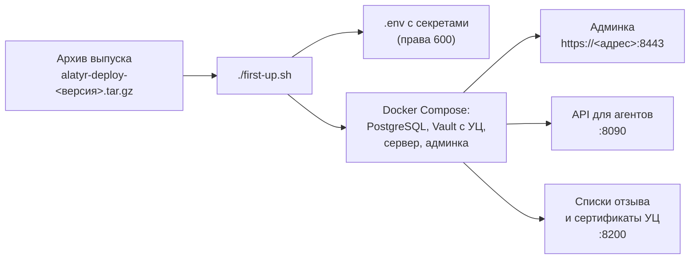

# Быстрый старт

Сервер Alatyr на одной машине с Docker — за несколько минут и одной
командой. Вы скачиваете архив выпуска, запускаете `./first-up.sh`, и он сам
придумывает все секреты, заводит собственный удостоверяющий центр (УЦ),
поднимает сервер и печатает адрес админки с паролем администратора.

Этот путь подходит для пилота и для знакомства с продуктом. Рабочая
установка со своим Vault, Keycloak или в Kubernetes — на странице
[Установка](installation.md).



## 1. Что нужно заранее

| Что | Требование |
|---|---|
| Машина | Linux, 2 ядра, 2 ГБ памяти, 20 ГБ диска (рекомендуется 4 ядра и 4 ГБ) — подробнее в [Расчёте ресурсов](sizing.md) |
| Docker | 24.0 или новее, `docker compose` подкомандой (не отдельный `docker-compose`); команды — от пользователя с доступом к Docker |
| Интернет | исходящий доступ к Docker Hub: образы `s3m4rgl/alatyr-server` и `s3m4rgl/alatyr-frontend` скачиваются при первом запуске |
| Свободные порты | `8443` — админка по HTTPS, `3000` — HTTP, перенаправляет на `8443`, `8090` — API для агентов, `8200` — списки отзыва и сертификаты УЦ для агентов |
| Сеть | `8090` и `8200` открыты из сети, где стоят машины сотрудников |
| Время | синхронизировано (`timedatectl status`) |

## 2. Скачайте архив выпуска

Все файлы выпуска — на странице
[последнего выпуска](https://github.com/s3m4rgl/alatyr-docs/releases/latest).
Сервер поднимается из архива `alatyr-deploy-<версия>.tar.gz`. Рядом с ним
выложены `docker-compose.yml` и `env.example` из того же архива — их можно
посмотреть до скачивания. В архиве второй файл называется `.env.example`:
имя с точкой в начале страница выпуска не принимает.

```bash
VER=1.5.7      # номер выпуска со страницы выпуска
curl -fLO https://github.com/s3m4rgl/alatyr-docs/releases/download/v$VER/alatyr-deploy-$VER.tar.gz
sha256sum alatyr-deploy-$VER.tar.gz
```

Сверьте напечатанную сумму с разделом «Контрольные суммы» на странице
выпуска. Не совпала — архив повреждён или подменён, не распаковывайте его.

Версия образов сервера уже вписана в архив: набор и образы приходят парой,
выбирать тег не нужно.

## 3. Распакуйте и запустите

```bash
tar -xzf alatyr-deploy-$VER.tar.gz
cd alatyr-deploy-$VER
./first-up.sh
```

Что делает `first-up.sh`:

1. Проверяет, свободны ли порты `8443`, `3000`, `8090`, `8200`. Если порт
   занят другой программой, сценарий ничего не запускает и называет порт и
   переменную, которой его поменять.
2. Заводит `.env` из `.env.example` и **придумывает недостающие секреты**:
   пароли базы и администратора, ключи подписи и шифрования. Файл получает
   права `600`.
3. Вписывает адрес машины, по которому агенты будут забирать списки отзыва
   (`ALATYR_PKI_PUBLIC_ADDR`). Если у машины один адрес — подставляет его
   сам, если несколько — спрашивает, какой из них видят агенты. Этот адрес
   попадает внутрь каждого выданного сертификата, поэтому выберите его
   внимательно. Для DNS-имени — флаг: `./first-up.sh --pki-addr alatyr.example.com`.
4. Скачивает образы и поднимает состав: PostgreSQL, Vault с корневым УЦ
   `Alatyr Root CA` и промежуточными УЦ для целей, сервер и админку за
   HTTPS. Сертификат админки выпускается на имя и IP-адреса машины.
5. Дожидается сервера и печатает **один блок «ЗАПИШИТЕ ЭТО СЕЙЧАС»**: адрес
   админки, отпечаток SHA-256 корня `Alatyr Root CA`, логин и пароль
   администратора, доступ к базе и где лежит ключ распечатывания Vault.

!!! warning "Блок печатается один раз"
    Сохраните его сразу в надёжное место. Повторный запуск `./first-up.sh`
    секреты не печатает и не меняет — они остаются в `.env`.

Свои логин и пароль администратора можно задать до первого запуска:
`cp .env.example .env`, впишите `ALATYR_ADMIN_EMAIL` и `ALATYR_ADMIN_PASSWORD`,
затем `./first-up.sh`. Сценарий заполняет только пустые значения. Пароль —
не короче 8 символов, с заглавной буквой, строчной и цифрой.

## 4. Проверьте, что поднялось

Из каталога набора:

```bash
docker compose ps -a
curl -s http://localhost:8090/health
curl -s http://localhost:8090/api/v1/version
```

Все службы — в состоянии `healthy`, одноразовые `vault-init` и
`issuers-init` завершились с кодом `0`, а сервер отвечает своей версией.

Если сервер не поднялся, `first-up.sh` вместо блока «ЗАПИШИТЕ» печатает
хвост журнала сервера и выходит с кодом `1`. Журнал целиком —
`docker compose logs server`.

## 5. Войдите в админку

1. Добавьте корень `Alatyr Root CA` в доверенные корневые сертификаты
   браузера или системы. Скачать его можно по ссылке из блока, вида
   `http://<адрес>:8200/v1/pki/ca/pem`. Перед установкой сверьте отпечаток
   SHA-256 с напечатанным в блоке. Без этого шага браузер предупредит о
   сертификате.
2. Откройте адрес админки из блока — `https://<адрес машины>:8443`.
3. Войдите логином и паролем администратора из блока.

**Результат.** Вы в админке, внизу боковой панели — ваша учётная запись с
ролью «Администратор».

!!! tip "Пароль верный, а вход не проходит"
    Админка открыта по имени, которого нет в списке имён сертификата, или
    по `http://`. Откройте её по адресу `https://…` из блока. Нужно другое
    имя — допишите его в `ALATYR_TLS_NAMES` в `.env` и повторите
    `./first-up.sh`.

## 6. Смените пароль администратора

Внизу боковой панели под вашей учётной записью — кнопка **«Сменить
пароль»**. Смените пароль сразу после первого входа: прежнее значение
остаётся в `.env` на диске. После первого запуска пароль меняется только в
админке — правка `.env` на него уже не влияет.

Забыли пароль — сбросьте его с машины сервера, из каталога набора:

```bash
docker compose exec server alatyr-server reset-admin-password --email admin@example.com
```

Новый пароль печатается один раз; все прежние сессии перестают действовать.

## Что дальше

Установка поднимается пустой: в ней только администратор. Дальше —

- **Первые шаги в админке:** издатели целей, политика выдачи, назначение
  целей устройствам — раздел «Первые шаги после запуска» в `README.md`
  архива и маршрут пилота [Пилот: с чего начать](pilot.md).
- **Агенты на устройства сотрудников:** [Установка → Агент](installation.md#агент)
  и [Агенты](agents.md). Агенту при установке дают адрес **API**, а не
  админки, и с портом: `http://<адрес машины>:8090` (порт `ALATYR_API_PORT`
  из `.env`). Адрес без порта, `https://<адрес машины>`, ведёт на порт 443,
  где в такой установке ничего не слушает. Если перед API поставлен ваш
  обратный прокси с TLS — давайте адрес прокси.
- **Все настройки сервера** и переменные `.env` — [Конфигурация](configuration.md).
- **Перед рабочей эксплуатацией:** свой Vault вместо встроенного
  (`OWN-VAULT.md` в архиве), TLS перед API, резервная копия тома
  `vault_data` — [Установка](installation.md) и
  [Отказоустойчивость (HA)](ha.md).

## Обновление

Новая версия ставится из архива нового выпуска по инструкции `UPGRADE.md`
внутри него. Коротко: сначала резервная копия базы и Vault — миграции базы
назад не откатываются, — затем файлы набора новой версии и новая версия в
`.env`, затем подъём. Данные, настройки и выданные сертификаты сохраняются.

## Остановка и удаление

Из каталога набора:

```bash
docker compose down        # остановить, данные сохранить
docker compose up -d       # запустить снова
docker compose down -v     # остановить и УДАЛИТЬ базу и Vault целиком
```

!!! danger "`down -v` необратим"
    Вместе с томом `vault_data` исчезает корень УЦ: все выданные
    сертификаты становится нечем проверять и отзывать.
